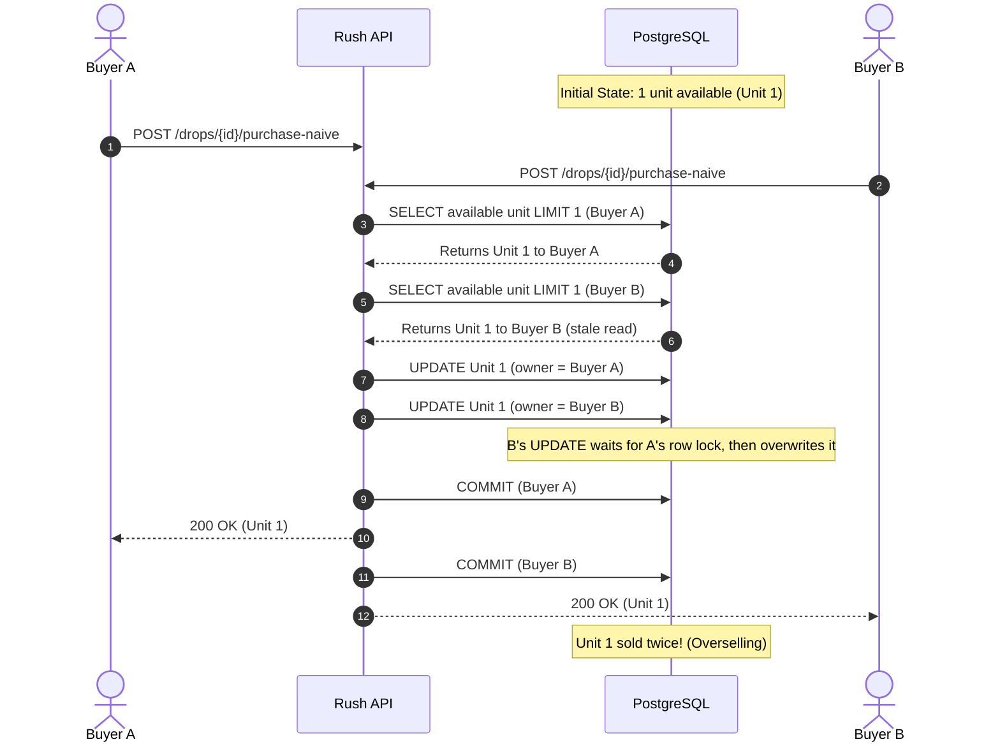
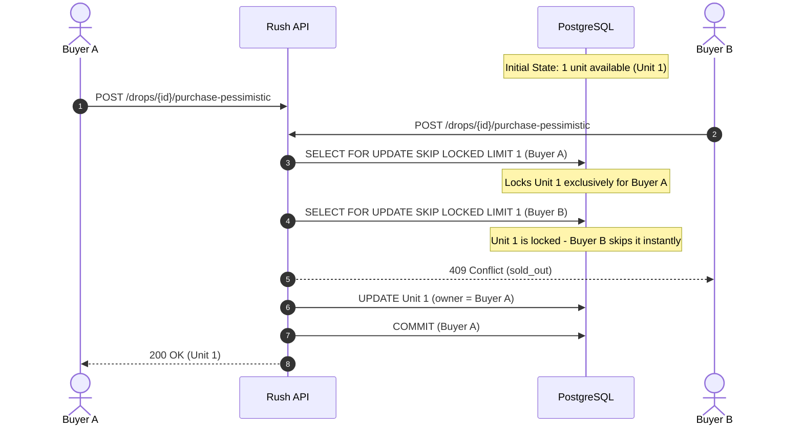
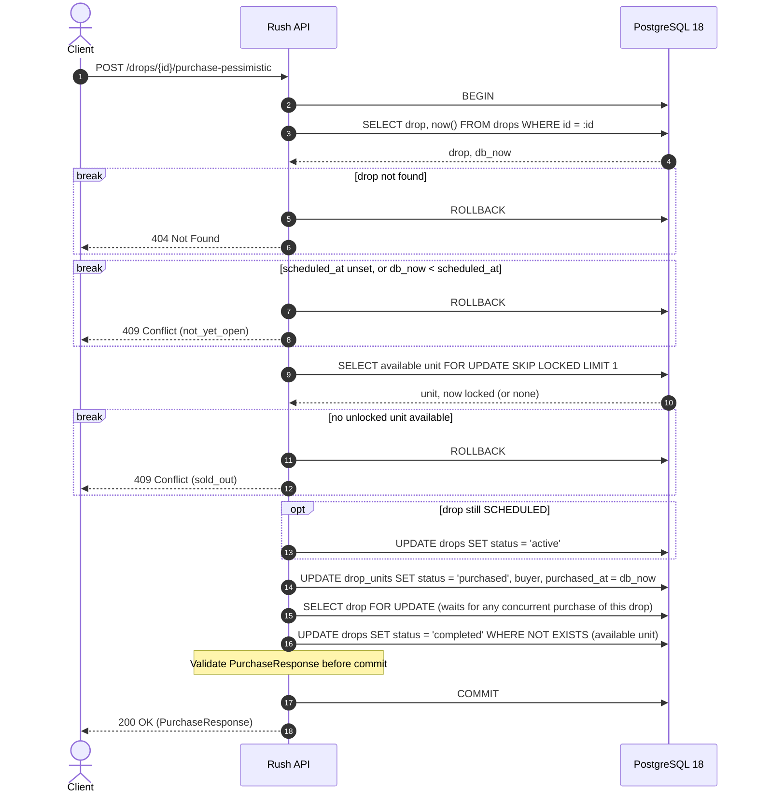

# Rush API

[](https://github.com/ruisilva-dev/rush/actions/workflows/ci.yml)


Flash-sale inventory API that prevents overselling under concurrent load.

Built with **FastAPI**, **SQLAlchemy 2.0 (asyncpg)**, and **PostgreSQL 18**, Rush explores how a relational database handles concurrent checkouts of a scarce inventory pool, comparing naive transactional behavior against non-blocking row-level locking (`SELECT ... FOR UPDATE SKIP LOCKED`).

---

## The Problem

During high-demand ticket drops or sneaker releases, many users can attempt to purchase from a scarce inventory pool at nearly the same time.

Under standard PostgreSQL `READ COMMITTED` isolation, naive read-then-write checkouts cause **lost updates and overselling**: multiple transactions read the same available unit before either commits. Non-blocking pessimistic locking resolves this by skipping rows already locked by in-flight checkouts.

### 1. Naive Path: Race Condition & Overselling (`/purchase-naive`)



### 2. Pessimistic Path: Non-Blocking Row Locking (`/purchase-pessimistic`)



---

## Request Lifecycle

The pessimistic purchase flow (`POST /drops/{id}/purchase-pessimistic`) encapsulates atomic status transitions, DB clock verification, row-level locks, and conditional completion inside a single transactional boundary:



---

## Architectural Decisions (ADRs)

### 1. Sequential Index Locality with UUIDv7
* **Decision**: All entities (`Drop`, `DropUnit`) generate primary keys using PostgreSQL 18's native `uuidv7()` server default.
* **Why**: Auto-incrementing integers are enumerable, which leaks creation order and volume through a public API. Random UUIDv4 identifiers fix that but scatter inserts across the primary-key B-Tree, causing page splits and poor cache locality. UUIDv7 starts with a 48-bit UNIX millisecond timestamp, so IDs are still non-enumerable and globally unique but arrive in roughly chronological order, keeping inserts clustered at the right edge of the index.

### 2. Container-Native File Secret Resolution
* **Decision**: Application database credentials are read exclusively from a mounted secret file (`POSTGRES_PASSWORD_FILE`, default `/run/secrets/db_user_password`). Startup fails fast with an explicit error if the secret file is missing or empty.
* **Why**: Plaintext environment variables (`POSTGRES_PASSWORD`) leak into `docker inspect`, `/proc/<pid>/environ`, child processes, and crash telemetry. A Compose file secret is mounted read-only into the containers instead, so the password never appears in container metadata or the process environment.
* **Note**: With Compose, the secret is a bind mount of the host's `secrets/db_user_password.txt` (git-ignored), not an in-memory tmpfs. Tmpfs-backed secrets would require Swarm or an external secret manager.

### 3. `SKIP LOCKED` vs Plain `FOR UPDATE`
* **Decision**: Concurrency control uses `SELECT ... FOR UPDATE SKIP LOCKED` instead of standard `FOR UPDATE`.
* **Why**: Plain `FOR UPDATE` makes concurrent transactions competing for inventory wait in a serialized queue on the same row lock, holding a connection while they wait. `SKIP LOCKED` skips locked rows immediately and claims the next available row. This is a design rationale, not a measured result: no benchmark in this repo compares the two yet.
* **Accepted Trade-off**: If an in-flight transaction holding a locked row subsequently encounters an error and rolls back, a concurrent buyer might receive a transient `409 sold_out` error during that millisecond window, even though that unit returns to the pool shortly after. For flash drops, failing fast without blocking is preferred over lock queues.

### 4. In-Transaction Pydantic Serialization
* **Decision**: Pydantic response models (`PurchaseResponse.model_validate(unit)`) are instantiated and validated *inside* the `async with db.begin():` block before the transaction commits.
* **Why**: If schema validation fails after a transaction commits, the client receives an HTTP 500 Internal Server Error while the database has already committed the inventory purchase (the "orphaned commit" hazard). Validating prior to commit guarantees that any serialization defect triggers an automatic transaction rollback.

### 5. Single Source of Chronological Truth: Database Clock Authority
* **Decision**: Drop opening eligibility is evaluated against PostgreSQL's clock (`func.now()`), never the application container's local clock (`datetime.now()`).
* **Why**: In distributed deployments with multiple application instances, server clocks drift (NTP jitter). Comparing schedule milestones against container clocks allows clients hitting a drifted worker to purchase ahead of schedule. Sourcing time from PostgreSQL guarantees a single source of chronological truth.
* **Details**: PostgreSQL's `now()` returns the *transaction start* time, so a single request sees one consistent `db_now` for the eligibility check and `purchased_at`. A drop is open when `db_now >= scheduled_at`. The only app-clock use is the create-time check that `scheduled_at` is in the future (`app/schemas/drop.py`), which doesn't gate purchases.

### 6. Atomic Drop Completion via Conditional `WHERE NOT EXISTS`
* **Decision**: Marking a drop `COMPLETED` runs via an atomic conditional SQL update: `UPDATE drops SET status = 'completed' WHERE id = :id AND NOT EXISTS (...)`.
* **Why**: Under PostgreSQL's `READ COMMITTED` isolation, a statement only sees *committed* data. With `SKIP LOCKED`, two buyers of the last two units claim different rows in parallel, so each one's `NOT EXISTS` sees the other's uncommitted unit as still available and neither would complete the drop. To prevent that, finalization takes a row lock on the drop (`SELECT ... FOR UPDATE`) right before the conditional update. The later buyer waits for the earlier commit, and its update (a new statement, hence a new snapshot) observes zero remaining units and marks the drop `COMPLETED`. No table-level locks are needed.
* **Accepted Trade-off**: The drop row lock is held from that point until commit, so the *tail* of concurrent purchases of the same drop is serialized. Claiming a unit stays non-blocking, and the lock only covers finalization plus the commit. This is covered by `test_purchase_pessimistic_concurrent_last_units_complete_active_drop`.

---

## Known Trade-offs

### Stale `SCHEDULED` Status in Read Endpoints
* **Current Behavior**: A drop transitions from `SCHEDULED` to `ACTIVE` inside the purchase transaction. Until the first purchase attempt occurs, `GET /drops` and `GET /drops/{id}` continue displaying `status = 'scheduled'` even after `scheduled_at` has passed.
* **Why Accepted**: The application is an API backend with no frontend listing dependency yet. Purchasing logic evaluates `db_now >= drop.scheduled_at` directly and does not depend on the stored column value. When consumer listings require real-time display accuracy, the effective status will be computed at read time:
  ```sql
  CASE WHEN status = 'scheduled' AND scheduled_at <= now() THEN 'active' ELSE status END
  ```

---

## Testing Strategy

Testing database concurrency cannot rely on mocked sessions. Rush uses a two-tier testing architecture inside isolated Docker containers:

```
tests/
├── conftest.py                   # Fixture harnesses (Savepoints vs NullPool)
├── test_config.py                # Secret resolution & validation
├── test_db.py                    # Session lifecycle & BaseException rollback
├── test_drops.py                 # Drop creation, validation, and listing
├── test_drop_lifecycle.py        # SCHEDULED -> ACTIVE -> COMPLETED lifecycle
├── test_purchase_naive.py        # Demonstrates overselling race conditions
└── test_purchase_pessimistic.py  # Verifies SKIP LOCKED concurrency under load
```

### 1. Single-Client Tests (Fast Savepoint Rollbacks)
* **Fixtures**: `client` and `db_session`.
* **Mechanism**: Runs on a single leased connection wrapped in an outer transaction using nested savepoints (`join_transaction_mode="create_savepoint"`). Tests run against a real PostgreSQL and roll back upon completion, leaving zero dirty state.

### 2. Multi-Client Concurrency Tests (Real Physical Isolation)
* **Fixtures**: `concurrent_client` and `committed_session`.
* **Why Real Commits Are Mandatory**: In PostgreSQL, row-level locks (`FOR UPDATE SKIP LOCKED`) and transaction isolation boundaries exist **between separate physical client connections**. Running multiple async workers over a shared connection or savepoint cannot simulate real lock contention.
* **Clean Isolation**: Concurrency test engines use `poolclass=NullPool` so connections are physically opened and discarded immediately. Fixture teardown enforces `SET LOCAL lock_timeout = '2s'` and executes `TRUNCATE TABLE drops CASCADE;` guarded by `try...finally` blocks to guarantee no transaction lock leaks persist into subsequent tests.

---

## Quickstart

### Prerequisites
* [Docker](https://docs.docker.com/get-docker/) & Docker Compose
* [uv](https://docs.astral.sh/uv/) (optional, for host-level linting)
* `make`

### 1. Initialize Secrets and Environment
```bash
# Generate the database password secret (mounted into the containers at /run/secrets).
# This is a throwaway dev password; use your own value.
mkdir -p secrets
echo "rush_super_secret_password" > secrets/db_user_password.txt
chmod 600 secrets/db_user_password.txt

# Copy environment variables
cp .env.example .env
```

### 2. Launch Services
```bash
# Build and start PostgreSQL 18 and FastAPI web server.
# This runs in the foreground, so use a second terminal for the next steps.
make up
```

### 3. Run Database Migrations
```bash
make migrate
```

Once running, interactive OpenAPI / Swagger documentation is available at **http://localhost:8000/docs**.

### 4. Try a Purchase
| Method | Path | Purpose |
|--------|------|---------|
| `POST` | `/drops` | Create a drop (`name`, `total_units`, optional `scheduled_at`) |
| `GET` | `/drops`, `/drops/{id}` | List drops / fetch one, with `available_units` |
| `POST` | `/drops/{id}/purchase-naive` | Baseline purchase, **vulnerable to overselling** |
| `POST` | `/drops/{id}/purchase-pessimistic` | Purchase with `FOR UPDATE SKIP LOCKED` |
| `GET` | `/health` | Liveness check |

Requires `jq`, `uuidgen`, and GNU `date`:
```bash
# Create a drop with 3 units that opens in 1 minute
DROP_ID=$(curl -s -X POST localhost:8000/drops \
  -H 'Content-Type: application/json' \
  -d "{\"name\": \"Sneaker Drop\", \"total_units\": 3, \"scheduled_at\": \"$(date -u -d '+1 minute' +%FT%TZ)\"}" | jq -r .id)

# Once it has opened, buy a unit (a 409 `not_yet_open` means wait a bit longer)
curl -s -X POST "localhost:8000/drops/$DROP_ID/purchase-pessimistic" \
  -H 'Content-Type: application/json' \
  -d "{\"user_id\": \"$(uuidgen)\"}"
```

### 5. Run the Test Suite
Tests execute in an isolated containerized PostgreSQL environment:
```bash
# Run the entire test suite (unit + concurrency)
make test

# Run tests and clean up containers
make test-clean
```

### 6. Linting & Formatting
```bash
uv run ruff check app alembic tests
uv run ruff format --check app alembic tests
```

---

## License

This project is licensed under the MIT License - see the [LICENSE](LICENSE) file for details.
