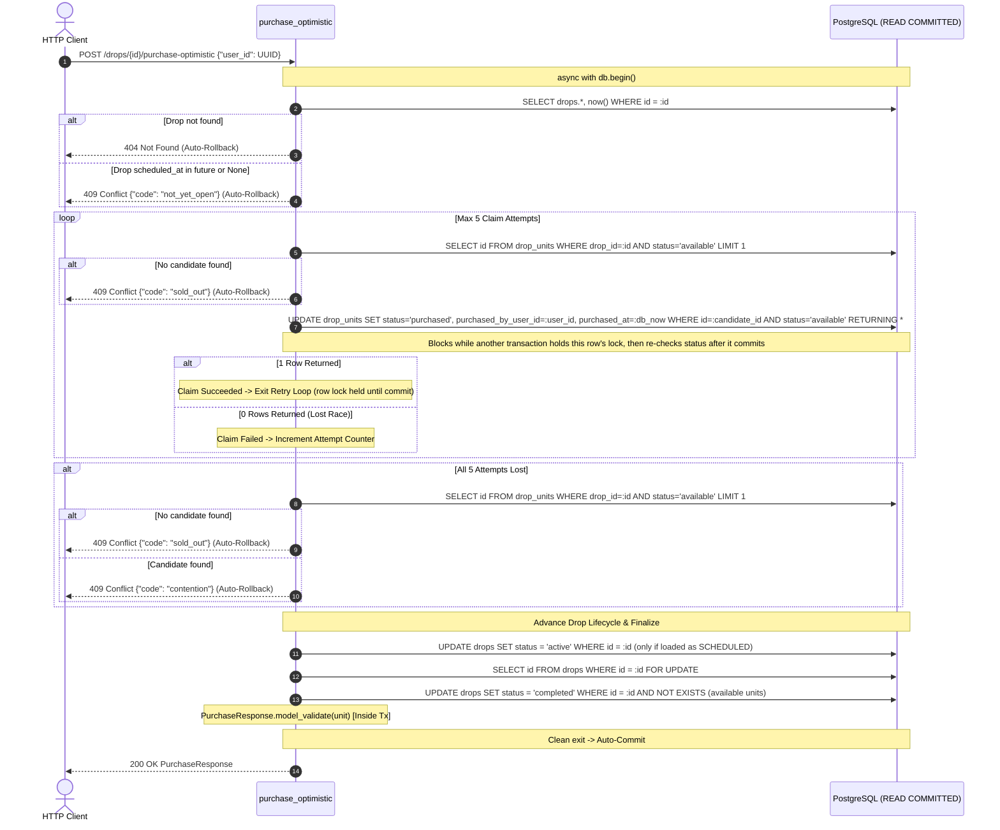

# Technical Specification: Optimistic Concurrency Strategy (Spec 11)

## 1. Overview, Scope and Requirements

### Problem Statement
The Rush API currently implements two purchase concurrency patterns:
1. **Naive Purchase** (`POST /drops/{id}/purchase-naive`): Selects the first available unit and mutates it without row locks. Under concurrent load, multiple transactions observe the same unit as available, causing severe silent overselling.
2. **Pessimistic Purchase** (`POST /drops/{id}/purchase-pessimistic`): Uses row-level locking via `SELECT ... FOR UPDATE SKIP LOCKED`. This guarantees zero overselling and lets buyers claim different units without waiting on each other's unit locks. It does not provide FIFO ordering, and buyers still serialize on the drop row lock during finalization.

To substantiate the core portfolio narrative ("Optimistic locking thrashes under hot contention while `SKIP LOCKED` excels at queue-like workloads"), Rush requires a third concurrency strategy: **Optimistic Concurrency Control (OCC)** via `POST /drops/{id}/purchase-optimistic`.

In this strategy:
- A candidate unit is selected *without* row locks (`SELECT DropUnit.id ... LIMIT 1`).
- The unit claim is executed via an atomic conditional SQL update: `UPDATE drop_units SET status='purchased', ... WHERE id=:candidate_id AND status='available' RETURNING ...`.
- The conditional `UPDATE` takes a row lock that is held until commit. A concurrent buyer targeting the same unit blocks on that lock, then re-evaluates the predicate once the winner commits. If the unit is no longer available, the update affects 0 rows and the buyer tries a fresh candidate, up to `MAX_CLAIM_ATTEMPTS = 5` claims in total.
- If all claim attempts are lost and units are still visible, the endpoint responds with HTTP 409 `contention`. If none are visible, it responds with HTTP 409 `sold_out`.
- Selling a unit to more than one buyer must be impossible. Bounded retries mean a drop can undersell: this is an accepted trade-off of the strategy, see AC-11.7 and ADR 11.2.

### Explicit Non-Goals
* Modifying the underlying database schema or Alembic migrations (the schema already supports `purchased_by_user_id`, `purchased_at`, and `status`).
* Modifying public contracts of existing endpoints (`purchase-naive`, `purchase-pessimistic`, `create_drop`, `list_drops`, `get_drop`).
* Introducing distributed cache or lock systems (e.g., Redis). All concurrency is managed strictly within PostgreSQL 18 and SQLAlchemy 2.0.
* Changing per-user purchase limits or authentication (deferred to Iterations B and C).
* Reducing contention by randomizing or partitioning candidate selection. This spec deliberately keeps the hot-row workload that the benchmark compares against `SKIP LOCKED`.

### Functional Requirements & Acceptance Criteria
* **AC-11.1 (Route Exposure)**: Expose `POST /drops/{id}/purchase-optimistic` accepting `PurchaseRequest` (`{"user_id": UUID}`) and returning typed `PurchaseResponse` with HTTP 200 OK.
* **AC-11.2 (Atomic Transaction Boundary)**: All database interactions inside `purchase_optimistic` must be encapsulated within an explicit `async with db.begin():` block adhering to the transaction contracts established in Spec 9 ([specs/9-api-transaction-and-serialization-contracts.md](file:///home/rilay/rush/specs/9-api-transaction-and-serialization-contracts.md)).
* **AC-11.3 (Lifecycle & Schedule Enforcement)**:
  - Return HTTP 404 if the drop ID does not exist (`detail="Drop with ID '{id}' not found"`).
  - Use the PostgreSQL clock (`func.now()`). If `drop.scheduled_at is None` or `db_now < drop.scheduled_at`, raise HTTP 409 with `{"code": "not_yet_open", "message": "Drop isn't open yet."}`.
* **AC-11.4 (Unlocked Candidate Read & Atomic Conditional Claim)**:
  - Read candidate available units without row locks (`without with_for_update`), through a `_select_claim_candidate` helper that tests can replace.
  - Claim candidate via `UPDATE drop_units ... WHERE id = :candidate_id AND status = 'available' RETURNING drop_units`.
  - If 0 rows return, loop and select a new candidate.
* **AC-11.5 (Bounded Retry & Error Classification)**:
  - Bounded at `MAX_CLAIM_ATTEMPTS = 5` claim attempts.
  - If no candidate exists initially or during retries because inventory is genuinely exhausted, raise HTTP 409 `{"code": "sold_out", "message": "No units currently available for this drop."}`.
  - After the final lost claim attempt, select a candidate once more. If none exists, raise HTTP 409 `sold_out`.
  - If that final check still finds a candidate, raise HTTP 409 `{"code": "contention", "message": "High contention; purchase could not be completed after retries."}`. Uncommitted claims still count as visible, so `contention` means inventory was visible at the check, not that a unit was guaranteed to remain unsold.
* **AC-11.6 (Shared Finalization & Lifecycle Progression)**:
  - Refactor `_finalize_purchase` into modular components to decouple unit attribute assignment from drop state transition.
  - Advance drop status from `SCHEDULED` to `ACTIVE` when `db_now >= drop.scheduled_at`.
  - Atomically advance drop status to `COMPLETED` when the last unit is purchased using the serialized drop row lock and conditional `UPDATE drops ... WHERE NOT EXISTS (...)`.
  - All three purchase strategies must lock the claimed unit before the drop row (see ADR 11.4).
* **AC-11.7 (Sale Integrity Guarantee)**: Under concurrent load with $N$ competing buyers and $M$ units:
  - **Always**: at most $M$ units are sold, and no unit is ever purchased by more than one buyer.
  - **When $M \le 5$ and $N \ge M$**: exactly $M$ units are sold and `contention` is never returned. A buyer loses a claim only when another buyer has committed a different unit, so losing all 5 attempts means at least 5 units are already sold.
  - **When $N \le 5$ and $M \ge N$**: every buyer succeeds, because a buyer can lose to at most $N - 1 \le 4$ others.
  - **Otherwise**: fewer than $M$ units may be sold, because buyers can exhaust their attempts while units remain. With $M = N = 6$, one buyer can lose 5 times and leave a unit unsold. This is timing-dependent, was observed in 1 of 50 prototype runs, and must not be asserted either way in tests.
  - These bounds assume no request fails for an unrelated reason, such as a server or database error.
* **AC-11.8 (TDD Test Suite)**: Provide comprehensive unit and concurrency test coverage in `tests/test_purchase_optimistic.py` based on `test_purchase_pessimistic.py` (see Section 8), and register the endpoint in `tests/test_drop_lifecycle.py`.

### Non-Functional Requirements
* **Atomicity & Consistency**: ACID guarantees under PostgreSQL `READ COMMITTED` isolation level. Retrying inside one transaction relies on `READ COMMITTED` taking a new snapshot per statement; it would not observe fresh candidates under `REPEATABLE READ`. Pydantic validation must execute inside the transaction block before commit to prevent orphaned commits.
* **Compatibility**: Native Python 3.12, asyncpg, SQLAlchemy 2.0 ORM, PostgreSQL 18.
* **Blast Radius Containment**: Confined exclusively to [app/api/drops.py](file:///home/rilay/rush/app/api/drops.py), [tests/test_purchase_optimistic.py](file:///home/rilay/rush/tests/test_purchase_optimistic.py), and [tests/test_drop_lifecycle.py](file:///home/rilay/rush/tests/test_drop_lifecycle.py).

---

## 2. Architecture and Execution Flow

### Request Lifecycle Diagram


### Module Refactoring Boundaries
Currently, [app/api/drops.py](file:///home/rilay/rush/app/api/drops.py#L29-L66) couples in-memory unit mutation with drop lifecycle transitions:
```python
# app/api/drops.py (Current implementation)
async def _finalize_purchase(db, drop, unit, user_id, db_now):
    if drop.status == DropStatus.SCHEDULED and db_now >= drop.scheduled_at:
        drop.status = DropStatus.ACTIVE
    unit.status = DropUnitStatus.PURCHASED
    unit.purchased_by_user_id = user_id
    unit.purchased_at = db_now
    await db.flush()
    await db.execute(select(Drop.id).where(Drop.id == drop.id).with_for_update())
    has_available = select(DropUnit.id).where(...).exists()
    await db.execute(
        update(Drop)
        .where(Drop.id == drop.id, ~has_available)
        .values(status=DropStatus.COMPLETED)
    )
```

Under optimistic concurrency, the `UPDATE drop_units ... RETURNING` statement performs the unit mutation directly in PostgreSQL. If `_finalize_purchase` were called as-is, it would redundantly re-assign attributes and trigger a second flush.

**Refactoring Plan**:
1. Extract `_advance_drop_lifecycle(db: AsyncSession, drop: Drop, db_now: datetime) -> None`:
   - Activates `SCHEDULED` drops if `db_now >= drop.scheduled_at`.
   - Acquires the serialized drop row lock (`SELECT Drop.id ... FOR UPDATE`).
   - Executes atomic conditional completion (`UPDATE Drop ... WHERE ~has_available`).
2. Retain `_finalize_purchase(...)` as a wrapper for `purchase_naive` and `purchase_pessimistic`, keeping their HTTP contracts unchanged:
   - Sets unit status, owner, and timestamp, flushes, then delegates to `_advance_drop_lifecycle`.
   - **Internal behavior change**: for a `SCHEDULED` drop, these endpoints currently emit `UPDATE drops` before `UPDATE drop_units`. After the refactor they emit `UPDATE drop_units` first (confirmed from the emitted SQL in a prototype). This is intentional, see ADR 11.4.
3. In `purchase_optimistic`:
   - After the atomic `UPDATE ... RETURNING` returns the claimed `unit`, invoke `_advance_drop_lifecycle(db, drop, db_now)`.

---

## 3. Interfaces, State and Contracts

### API Specification

#### `POST /drops/{id}/purchase-optimistic`
* **Path Parameter**: `id: UUID` (The target drop ID)
* **Request Header**: `Content-Type: application/json`
* **Request Body** (`PurchaseRequest`):
```json
{
  "user_id": "018f2d5e-990a-7df3-a5c2-df38d0e9ad11"
}
```

* **Success Response (200 OK)** (`PurchaseResponse`):
```json
{
  "unit_id": "018f2d5e-990a-7df3-a5c2-df38d0e9ad12",
  "drop_id": "018f2d5e-990a-7df3-a5c2-df38d0e9ad10",
  "user_id": "018f2d5e-990a-7df3-a5c2-df38d0e9ad11",
  "status": "purchased"
}
```

* **Error Responses**:
  - `404 Not Found`:
    ```json
    { "detail": "Drop with ID '018f2d5e-...' not found" }
    ```
  - `409 Conflict (not_yet_open)`:
    ```json
    { "detail": { "code": "not_yet_open", "message": "Drop isn't open yet." } }
    ```
  - `409 Conflict (sold_out)`:
    ```json
    { "detail": { "code": "sold_out", "message": "No units currently available for this drop." } }
    ```
  - `409 Conflict (contention)`:
    ```json
    { "detail": { "code": "contention", "message": "High contention; purchase could not be completed after retries." } }
    ```
  - `422 Unprocessable Entity`: Malformed UUID in path or request body.

### Implementation Blueprint (`app/api/drops.py`)

```python
MAX_CLAIM_ATTEMPTS: int = 5


async def _advance_drop_lifecycle(
    db: AsyncSession,
    drop: Drop,
    db_now: datetime,
) -> None:
    """Advance drop lifecycle (SCHEDULED -> ACTIVE, and ACTIVE/SCHEDULED -> COMPLETED if exhausted)."""
    if drop.status == DropStatus.SCHEDULED and db_now >= drop.scheduled_at:
        drop.status = DropStatus.ACTIVE

    # Serialize finalization per drop. Under READ COMMITTED the NOT EXISTS below
    # only sees *committed* purchases, and buyers of different units can run in
    # parallel, so two concurrent last-unit buyers would each see the other's unit
    # as still available and neither would complete the drop. Taking the drop row
    # lock makes the later buyer wait for the earlier commit, and its conditional
    # UPDATE (a new statement, hence a new snapshot) then observes it.
    await db.execute(select(Drop.id).where(Drop.id == drop.id).with_for_update())

    has_available = (
        select(DropUnit.id)
        .where(
            DropUnit.drop_id == drop.id,
            DropUnit.status == DropUnitStatus.AVAILABLE,
        )
        .exists()
    )
    await db.execute(
        update(Drop)
        .where(Drop.id == drop.id, ~has_available)
        .values(status=DropStatus.COMPLETED)
    )


async def _finalize_purchase(
    db: AsyncSession,
    drop: Drop,
    unit: DropUnit,
    user_id: UUID,
    db_now: datetime,
) -> None:
    """Mark the unit purchased and advance the drop lifecycle (used by naive and pessimistic)."""
    unit.status = DropUnitStatus.PURCHASED
    unit.purchased_by_user_id = user_id
    unit.purchased_at = db_now
    await db.flush()

    await _advance_drop_lifecycle(db, drop, db_now)


async def _select_claim_candidate(db: AsyncSession, drop_id: UUID) -> UUID | None:
    """Read an available unit ID without locking it. Uncommitted claims still appear."""
    stmt = (
        select(DropUnit.id)
        .where(
            DropUnit.drop_id == drop_id,
            DropUnit.status == DropUnitStatus.AVAILABLE,
        )
        .limit(1)
    )
    return await db.scalar(stmt)


def _optimistic_sold_out_error() -> HTTPException:
    return HTTPException(
        status_code=status.HTTP_409_CONFLICT,
        detail={
            "code": "sold_out",
            "message": "No units currently available for this drop.",
        },
    )


@router.post("/{id}/purchase-optimistic", response_model=PurchaseResponse)
async def purchase_optimistic(
    id: UUID, payload: PurchaseRequest, db: AsyncSession = Depends(get_db)
) -> PurchaseResponse:
    async with db.begin():
        stmt = select(Drop, func.now()).where(Drop.id == id)
        result = await db.execute(stmt)
        row = result.first()

        if not row:
            raise HTTPException(
                status_code=status.HTTP_404_NOT_FOUND,
                detail=f"Drop with ID '{id}' not found",
            )

        drop, db_now = row
        if drop.scheduled_at is None or db_now < drop.scheduled_at:
            raise HTTPException(
                status_code=status.HTTP_409_CONFLICT,
                detail={"code": "not_yet_open", "message": "Drop isn't open yet."},
            )

        unit: DropUnit | None = None
        for _ in range(MAX_CLAIM_ATTEMPTS):
            candidate_id = await _select_claim_candidate(db, id)

            if candidate_id is None:
                raise _optimistic_sold_out_error()

            # Atomic conditional claim. Blocks on a concurrent claim of this row,
            # then re-checks status once that transaction commits.
            claim_stmt = (
                update(DropUnit)
                .where(
                    DropUnit.id == candidate_id,
                    DropUnit.status == DropUnitStatus.AVAILABLE,
                )
                .values(
                    status=DropUnitStatus.PURCHASED,
                    purchased_by_user_id=payload.user_id,
                    purchased_at=db_now,
                )
                .returning(DropUnit)
            )
            unit = await db.scalar(claim_stmt)
            if unit is not None:
                break

        if unit is None:
            # The final lost claim may have taken the last unit.
            if await _select_claim_candidate(db, id) is None:
                raise _optimistic_sold_out_error()

            raise HTTPException(
                status_code=status.HTTP_409_CONFLICT,
                detail={
                    "code": "contention",
                    "message": "High contention; purchase could not be completed after retries.",
                },
            )

        await _advance_drop_lifecycle(db, drop, db_now)

        # Validate inside transaction boundary
        response = PurchaseResponse.model_validate(unit)

    return response
```

---

## 4. Security and Trust Boundaries

### Threat Model & Attack Surface
* **ID Enumeration & Invalid UUIDs**: UUIDv7 / UUIDv4 validation by FastAPI/Pydantic rejects non-UUID strings with 422 before executing database queries.
* **Denial of Service via Infinite Retries**: The retry loop is strictly bounded (`MAX_CLAIM_ATTEMPTS = 5`). A client cannot force unbounded DB thrashing.
* **Race Condition / Concurrent Double-Spending**: Zero double-spend vulnerability. The claim step requires `DropUnit.status == DropUnitStatus.AVAILABLE` within PostgreSQL's atomic row-level update. Even under READ COMMITTED, PostgreSQL locks the row during the physical UPDATE evaluation and evaluates the predicate against the most recently committed version. If already changed to `purchased`, 0 rows match.
* **Orphaned State / Exception Safety**: Model serialization occurs inside `async with db.begin():`. If Pydantic validation fails, the transaction automatically rolls back, ensuring no unit remains purchased without an HTTP response.

---

## 5. Performance, Scalability and Resource Budgets

### Time and Space Complexity
* **Candidate Selection Query**: An indexed lookup utilizing the existing partial index `ix_drop_units_drop_id_available` on `drop_units (drop_id)` WHERE `status = 'available'` when the planner chooses it. It is not strictly $O(1)$: index entries for recently purchased rows remain until they are cleaned up, so scans can slow during a stampede.
* **Claim Update**: Primary key point update (`WHERE id = :candidate_id`), plus any time spent waiting on the row lock.
* **Retry Loop Worst-Case Complexity**: At most 5 candidate queries + 5 update statements + 1 final candidate query = 11 statements per failed request, excluding the initial drop read.
* **Connection Hold Time**: Not shorter than pessimistic locking under contention. A successful claim holds its row lock until commit, including while it waits for the drop row lock. Buyers targeting the same unit hold a pooled connection while blocked on that row, and may repeat this for each attempt.

### Expected Contention Profile
* **Uncontended / Low Load**: 1 candidate select + 1 update = 2 claim statements. Zero retries. Latency comparable to naive.
* **High Contention ($N \gg M$)**: Concurrent transactions tend to select the same available unit. Which row `LIMIT 1` returns is implementation-defined and depends on the query plan, so this concentration is expected, not guaranteed. One transaction wins and the others block on its row lock, match 0 rows after it commits, and loop. Requests continue until they succeed, observe `sold_out`, or return `contention`.
* **Interpretation**: The benchmark measures OCC with a hot candidate row. It must not be presented as a measurement of optimistic locking in general: this design waits on the row lock (not a spin of immediate failures) and a different candidate selection would collide less often.
* **Shared Bottleneck**: All three strategies serialize finalization on the same drop row lock. `SKIP LOCKED` avoids unit-row waits, but it cannot make commits for one drop run in parallel past that lock.

---

## 6. Failure Modes, Edge Cases and Observability

### Edge Cases and Failure Matrix

| Scenario | Condition | Expected Behavior |
| :--- | :--- | :--- |
| **Drop Not Found** | Query returns 0 rows | 404 Not Found |
| **Future Drop** | `db_now < drop.scheduled_at` | 409 `not_yet_open` |
| **Draft Drop** | `drop.scheduled_at is None` | 409 `not_yet_open` |
| **Initially Sold Out** | `candidate_id is None` on attempt 1 | 409 `sold_out` |
| **Exhausted During Retry** | `candidate_id is None` on attempt $k > 1$ | 409 `sold_out` |
| **Final Lost Claim Took Last Unit** | 5 claim attempts return 0 rows, final check finds no candidate | 409 `sold_out` |
| **High Contention Exhaustion** | 5 claim attempts return 0 rows, final check finds a candidate | 409 `contention` |
| **Undersell** | Buyers return `contention` and no remaining buyer claims the leftover units | Drop keeps its units available and stays `ACTIVE` |
| **Claim Holder Rolls Back** | Blocked `UPDATE` resumes and the row is still `available` | Blocked buyer claims the unit |
| **Last Unit Purchase** | `has_available` becomes false | Drop status transitions to `COMPLETED` |
| **Response Validation Failure** | Pydantic validation fails inside block | Auto-rollback; unit remains available |

### Telemetry & Logging
* Endpoint conforms to standard FastAPI exception handlers.
* Benchmark and integration scripts track error classification breakdown: `sold_out` vs `contention` vs `not_yet_open`.

---

## 7. Architecture Decisions and Trade-offs (ADR Log)

### ADR 11.1: Atomic Conditional UPDATE vs Application-Level Version Checking
* **Decision**: Use `UPDATE drop_units ... WHERE id = :candidate_id AND status = 'available' RETURNING drop_units` rather than a dedicated integer `version` column.
* **Alternatives Considered**: Adding a `version: Mapped[int]` column to `drop_units` and checking `WHERE id = :id AND version = :version`.
* **Rationale**: For this endpoint, `status = 'available'` already acts as the version check for the `AVAILABLE -> PURCHASED` transition. Adding a separate `version` column would require an Alembic migration for zero added consistency gain. The status predicate in PostgreSQL is natively atomic and guarantees that only one transaction can transition the state.

### ADR 11.2: Bounded Retry Limit of 5 Attempts
* **Decision**: Bound claims at 5 attempts before returning 409 `contention`.
* **Alternatives Considered**:
  - No retries (fail immediately on 1st collision): Leads to catastrophic failure rates under minor load.
  - Unbounded retry until sold out: Starves the connection pool and creates unbounded request latencies.
* **Rationale**: 5 attempts provide a reasonable window for buyers to snag an alternative unit in small drops while bounding worst-case DB execution time and connection hold times under extreme stampedes.
* **Consequence**: Buyers can give up while units remain, so a drop may undersell when more than 5 units are contested (AC-11.7). Unsold units remain purchasable by later requests. The strategy favors bounded latency over selling out in a single burst.

### ADR 11.3: Classification of Exhaustion as `sold_out`
* **Decision**: If `_select_claim_candidate` returns `None` on any attempt, or on the final check after the last lost claim, return 409 `sold_out` instead of `contention`.
* **Rationale**: Returning `contention` when inventory is genuinely zero is misleading to clients and consumers. If there are no units left in the drop, the true reason for purchase failure is exhaustion. The final check costs one extra read, only on the failure path, and a prototype without it returned `contention` for already-exhausted drops.
* **Limitation**: Uncommitted claims still appear available, so a `contention` response can still race with the last units being sold.

### ADR 11.4: Consistent Lock Order (Unit, Then Drop)
* **Decision**: All purchase strategies acquire the unit row before the drop row, including when activating a `SCHEDULED` drop.
* **Alternatives Considered**: Keeping the existing order (`UPDATE drops` before `UPDATE drop_units` for `SCHEDULED` drops) in naive and pessimistic.
* **Rationale**: `purchase_optimistic` must claim the unit before finalizing, so one order across strategies avoids opposing lock orders and removes the need for two lifecycle paths. HTTP contracts are unaffected. The prototype produced zero deadlocks in its Postgres log. `test_drop_lifecycle.py` covers activation and completion for all three endpoints.

---

## 8. TDD Implementation & Verification Plan

Following the **Bugfix & Implementation Protocol (TDD)** and **Agent Execution Rules** in [AGENTS.md](file:///home/rilay/rush/AGENTS.md):

### Step 1: Write Reproduction Tests First (Red)
Create [tests/test_purchase_optimistic.py](file:///home/rilay/rush/tests/test_purchase_optimistic.py) containing:
1. `test_purchase_optimistic_success_uncontended`: Single buyer, 200 OK, verify DB fields (`purchased_by_user_id`, `purchased_at`, `status == PURCHASED`).
2. `test_purchase_optimistic_not_yet_open_future_schedule`: 409 `not_yet_open`.
3. `test_purchase_optimistic_not_yet_open_draft`: 409 `not_yet_open`.
4. `test_purchase_optimistic_sold_out`: 409 `sold_out`.
5. `test_purchase_optimistic_route_errors`: 404 and 422 validations.
6. `test_purchase_optimistic_solve_silent_oversell`: 2 concurrent buyers racing for 1 unit; exactly 1 succeeds (200), 1 conflicts (409 `sold_out`).
7. `test_purchase_optimistic_contention_exhaustion`: Deterministic, no real race. Seed one purchased and one available unit. Use `monkeypatch.setattr("app.api.drops._select_claim_candidate", fake)` with a `fake` that always returns the purchased unit's ID. Assert 409 `contention`, exactly 6 helper calls (5 claim attempts + 1 final check), and that the available unit is unchanged.
8. `test_purchase_optimistic_final_lost_claim_reports_sold_out`: Same patch, but `fake` returns the purchased unit's ID for the first 5 calls and `None` on the 6th. Assert 409 `sold_out` and exactly 6 helper calls.
9. `test_purchase_optimistic_blocked_claim_retries_next_unit`: Deterministic lost race, using `committed_session` and `concurrent_client`:
   - Seed and commit units `U1` and `U2`. Patch the helper so its first call returns `U1` and later calls delegate to the real helper.
   - In `committed_session`, update `U1` to purchased by another buyer, without committing.
   - Start the request with `asyncio.create_task`. Poll `SELECT count(*) FROM pg_locks WHERE NOT granted` on `committed_session`, bounded at 5 seconds, until the request is waiting. Assert the task is not done.
   - Commit, await the task, and assert 200 with `unit_id == U2` and that `U1` still belongs to the other buyer.
   - In a `finally` block, roll back `committed_session` and cancel the task if it is unfinished. Do this before assertions finish, as AGENTS.md requires.
10. `test_purchase_optimistic_multi_unit_contention`: 5 concurrent buyers vs 5 units; verify all 5 units purchased with zero duplication. This is deterministic under AC-11.7.
11. `test_purchase_optimistic_more_buyers_than_units`: 10 concurrent buyers vs 3 units; exactly 3 return 200 with distinct unit IDs, 7 return 409 `sold_out`, none return `contention`, and the drop is `COMPLETED`. This is deterministic under AC-11.7.

Do not write tests that assert a specific sale count or `contention` count from a real race with more than 5 contested units. Those outcomes are timing-dependent and belong in the benchmark.

In [tests/test_drop_lifecycle.py](file:///home/rilay/rush/tests/test_drop_lifecycle.py):
- Update `ENDPOINTS = ["purchase-naive", "purchase-pessimistic", "purchase-optimistic"]`.
- Add `test_purchase_optimistic_concurrent_last_units_complete_drop`.
- Add `test_purchase_optimistic_concurrent_last_units_complete_active_drop`, mirroring the pessimistic version (20 `ACTIVE` drops, 2 buyers each).

Execute targeted runner to confirm failures:
```bash
./scripts/agent-test.sh file test_purchase_optimistic.py
./scripts/agent-test.sh file test_drop_lifecycle.py
```

### Step 2: Surgical Implementation (Green)
In [app/api/drops.py](file:///home/rilay/rush/app/api/drops.py):
- Extract `_advance_drop_lifecycle`.
- Update `_finalize_purchase` to use `_advance_drop_lifecycle`.
- Add `MAX_CLAIM_ATTEMPTS`, `_select_claim_candidate`, `_optimistic_sold_out_error`, and the `purchase_optimistic` handler.

### Step 3: Targeted Verification
Execute targeted test function and file:
```bash
./scripts/agent-test.sh func test_purchase_optimistic.py test_purchase_optimistic_success_uncontended
./scripts/agent-test.sh file test_purchase_optimistic.py
./scripts/agent-test.sh file test_drop_lifecycle.py
./scripts/agent-test.sh file test_purchase_naive.py
./scripts/agent-test.sh file test_purchase_pessimistic.py
```
The naive and pessimistic files must also pass because the refactor changes their internal statement order (ADR 11.4).

### Step 4: Code Quality & Diff Inspection
```bash
uv run ruff check app alembic tests && uv run ruff format --check app alembic tests
git diff --stat
```
